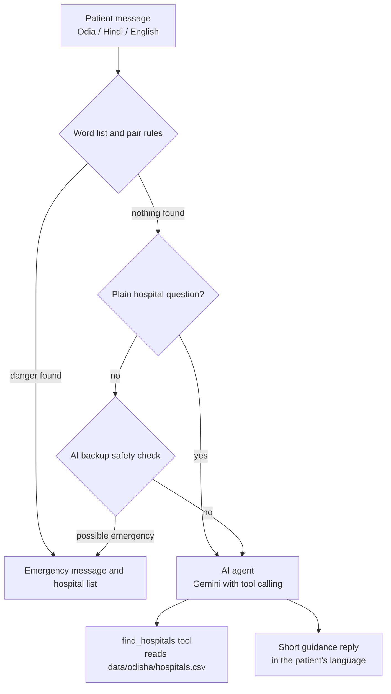

# Arogya Mitra 🩺

Multilingual (Odia, Hindi, English) health guidance for rural India.
**Pilot: Odisha.** Built for Code for a Billion: Bharat Agentic-AI Hackathon 2026.

**Live demo:** https://arogya-mitra-bharat.streamlit.app
If the app shows "This app has gone to sleep", click the wake-up button and wait up to a minute.

> Arogya Mitra gives general health guidance only. It is not a medical diagnosis tool and does not replace a doctor. In an emergency call 108.

## Problem
Many rural families find it hard to get quick, understandable health guidance in their own language.

## What it does
- **AI Assistant:** a chat that understands Odia, Hindi and English and replies in the patient's language, using simple words and no medicine names or doses.
- **Emergency detection:** danger signs (chest pain, trouble breathing, collapse, heavy bleeding, snake bite, childbirth problems and more) get a "call 108" message and a hospital list straight away.
- **Hospital Finder:** government hospitals for pilot districts, with the source of each entry.
- **Symptom Checker:** a simple rule-based tool in three languages.
- **Scope limits:** the assistant declines non-health questions.

## How it works

1. Plain code checks for emergencies first, before any AI reply.
2. A second AI check catches emergencies described in unusual words.
3. The AI agent answers in simple language and calls a tool to look up hospitals.
4. If a model is busy, retired or out of quota, the app tries the next one.

## Honest test results
Emergency detection only, using small test sets written by the developer. These do **not** measure the quality of the advice.

| Test set | Messages | Result | Note |
|---|---|---|---|
| Set 1 | 40 | 36/40 at first, 40/40 after fixes | Used to fix bugs |
| Unseen set 1 | 16 | 9/16 (word list only) | First run on new messages |
| Unseen set 2 | 12 | 6/12 (word list only) | Fixed word lists miss new wording |
| Unseen set 3 | 14 | 13/14 (word list + AI backup) | The one miss was a long-labour emergency, then the check was widened |

## What testing found, and what was fixed
- A fixed word list missed emergencies described in new words, so an AI backup check was added.
- The AI backup first missed a childbirth emergency, so pregnancy, labour and child danger signs were added to its question.
- The AI backup flagged plain hospital questions as emergencies, so a plain-code rule now skips it for messages that mention hospitals and no symptoms.
- The assistant first answered any question (general knowledge, college life), so a scope rule was added. Borderline cases are declined.
- A lighter model answered an English message in Odia, so the language rule was made explicit.
- Some Gemini model names were retired and free-tier quota ran out, so the app now skips unavailable models and tries the next one.
- A tester found that the chat input moved down after every message, so messages now sit in a fixed-height box.
- The AI backup flagged `mora jwara heuchi` (romanized Odia for "I have fever") as an emergency, because the lighter model could not read it and was told to answer YES when unsure. Fixed with a plain-code rule that skips the AI backup for short messages with only a mild symptom word and no danger hint.
- Hospital names come from an English-language data file, so they appear in English letters even in Odia replies.

Most of these were checked on only a few examples. A larger false-alarm test is still needed.

## User testing
Tested remotely by 1 friend on an android phone , in English. Everything worked normally except the chat layout bug above, which was fixed. Odia replies were checked by the developer, who speaks Odia . Not yet tested with a nurse, ASHA or ANM worker, or with people who are not comfortable with phones.

## Data
Hospital names for Bhubaneswar, Cuttack, Puri and Ganjam were checked against official district and state government pages in October 2026. Phone numbers are not included because they could not be verified. Some official pages use older data, so patients should confirm details before travelling. Names and types were checked, but not addresses, opening hours or services.

## Limitations
- Not clinically validated and not reviewed by a doctor
- Small test sets written by the developer, not by health workers
- Negation handling is simple ("no chest pain" works, complex sentences may not)
- Spellings of romanized Odia and Hindi vary, so some phrases may be missed
- The AI backup is only checked on a few examples
- Hospital data covers only four districts and may be out of date
- Replies depend on a third-party AI service. It can be busy, out of free quota, or wrong
- Odia and Hindi text was written by the developer and is not reviewed by a language expert
- The rule-based Symptom Checker uses simple placeholder thresholds that have not been reviewed by a doctor
- The assistant is checked mainly on short messages, and long or very unusual descriptions may be handled less well
- Romanized Odia is understood less reliably than Odia script
- To save free AI quota and avoid false alarms, the AI safety check is skipped for short messages that mention only a mild symptom. An emergency worded only with mild words could be missed, although the plain-code danger words still apply
- Hospital names are shown in English letters, even in Odia replies


## Privacy
Messages typed into the AI Assistant are sent to Google's Gemini API to generate replies. The app does not save chats on its own server, and a chat is cleared when the page is closed or the Clear chat button is pressed. Please do not enter real personal health details while this is a prototype.


## Run locally
```
pip install -r requirements.txt
```
Create a `.env` file with `GEMINI_API_KEY=your-key`, then:
```
streamlit run app.py
```
Never put your key in the repository.

## Adding districts
Add rows to `data/odisha/hospitals.csv` (name, district, type, phone, source) and add the district name to the sidebar list in `app.py`. Adding a new state needs a new data file and a small change to the data path. Making this fully configurable is on the roadmap.

## Roadmap
- Review by a doctor, nurse or ASHA/ANM worker
- A larger test set, including false-alarm tests
- More districts with verified data
- Voice input in Odia
- Configurable state data files

## License
MIT